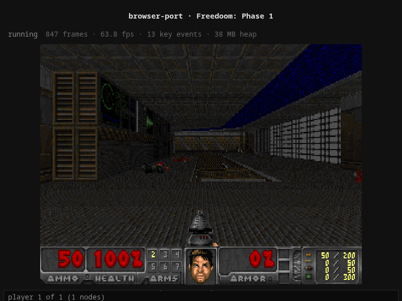

# browser-doom — a real game, running in a browser, with no native code

A DOOM port that runs entirely in the browser: the engine is compiled to
WebAssembly, it runs on its **own thread**, the 27 MB WAD is **streamed with
HTTP Range requests and cached in OPFS**, frames are presented **zero-copy**
from the WASM heap through WebGL2, and savegames round-trip through
**IndexedDB** across page reloads.

Three engine builds, all verified in headless Brave:

| build | shape | why it exists |
|---|---|---|
| `doom` | pthreads + `PROXY_TO_PTHREAD` | the shape every serious 2026 browser port uses — the engine owns a real thread, so blocking C code just works |
| `doom_async` | single thread + `ASYNCIFY` | the pre-JSPI trick: unwind a blocking C loop into the JS event loop. Fallback for hosts that cannot send COOP/COEP |
| `doom64` | pthreads + wasm64 | the 64-bit address space that let GTA V's browser build carry a multi-GB heap |



## Live

**https://browser-doom.onrender.com/?wad=%2Fdata%2Ffreedoom1.wad&build=doom&warp=1,1**

Runs on a Render free web service. Two things to know about a hosted port like this:

* the free instance **spins down when idle**, so the first visit after a while
  spends ~30 s pulling the 27 MB WAD through the edge; the next visit is served
  from the browser's OPFS cache and boots in **~3 s**
* it is a **web service, not a static site**: `SharedArrayBuffer` needs COOP/COEP,
  the asset streamer needs real `206` responses, and `/telemetry` needs a POST
  handler — a static host can give you none of that

Verified against the live URL with `node tools/livecheck.mjs`:

| build | boot | fps | Range requests | console errors |
|---|---|---|---|---|
| `doom` (pthreads) | 32.8 s cold | 70 | 54/54 answered `206` | none |
| `doom_async` | 28.9 s cold | 70 | 54/54 `206` | none |
| `doom64` (wasm64) | 3.3 s (OPFS cache hit) | 70 | 1 probe, served from cache | none |

`crossOriginIsolated: true` on the hosted origin, so the threaded build really
does run the engine off the main thread in production.


## Run it

```sh
# 1. toolchain (Emscripten)
git clone --depth 1 https://github.com/emscripten-core/emsdk.git ~/emsdk
cd ~/emsdk && ./emsdk install latest && ./emsdk activate latest

# 2. game data (FreeDoom: free IWAD, no commercial WAD needed)
tools/get-data.sh

# 3. build the three engine variants
bash build.sh

# 4. serve (the headers matter, see below)
python3 tools/serve.py 8765
# -> http://127.0.0.1:8765/?wad=%2Fdata%2Ffreedoom1.wad&build=doom
```

Query params: `build=doom|doom_async|doom64`, `wad=/data/whatever.wad`,
`warp=1,1` (skip the title screen), `skill=3`, `extra=-nomonsters`.

### Verify it actually plays

```sh
npm i puppeteer                      # drives Brave/Chrome
node tools/verify.mjs                # boot + input + console cleanliness -> PASS
node tools/playtest.mjs              # new game, walk, save, reload, restore -> PASS
node tools/builds.mjs                # all three variants boot and present
node tools/firetest.mjs              # Ctrl and mouse click really shoot (ammo 50 -> 47)
node tools/livecheck.mjs https://browser-doom.onrender.com doom,doom_async,doom64
```

`playtest.mjs` does not trust counters. It starts E1M1 with `-warp`, walks
forward, turns, and **diffs the screenshots** (54% and 72% of pixels changed
respectively), then saves into slot 1, reloads the page, and checks that the
save menu shows the description it typed — i.e. the bytes came back out of
IndexedDB and into the engine's filesystem.

## How it is put together

```
engine/doomgeneric/src/doomgeneric_browser.c   the whole OS layer, rewritten
web/app/app.js        boot: module -> saves -> WAD -> frame loop -> telemetry
web/app/wadstream.js  Range requests -> OPFS cache -> heap (or shared heap)
web/app/present.js    WebGL2 upload of a *view* of the engine's framebuffer
web/app/input.js      KeyboardEvent + Gamepad -> DOOM keycodes
web/app/saves.js      IndexedDB <-> engine filesystem
tools/serve.py        COOP/COEP, HTTP Range, /telemetry JSONL
```

The engine never learns it is in a browser. It calls `DG_Init`,
`DG_DrawFrame`, `DG_SleepMs`, `DG_GetTicksMs`, `DG_GetKey` — the doomgeneric
contract — and the platform layer answers with WASM-heap buffers, a key ring,
and `emscripten_sleep`/`usleep` depending on the build.

### The bridge (the interesting part)

Two threads share one WASM heap, so the interface is deliberately dumb:

* **stats block** — one struct at a fixed address the page thread reads
  directly (`frames`, `frame_seq`, `resx/resy`, `fb` pointer, counters). No
  postMessage for the hot path.
* **frame presentation** — the engine bumps `frame_seq`; the page thread polls
  it in `requestAnimationFrame` and uploads a `Uint8Array` *view* of the
  engine's own buffer with `texSubImage2D`. No copy, no swizzle: the heap holds
  `B,G,R,A` and the fragment shader swaps `r`/`b` on the way out.
* **input** — a lock-free key ring fed by `dg_push_key(code, pressed)`; the
  engine drains it in `I_GetEvent`. Gamepad axes are converted into held-key
  transitions because DOOM's input layer only understands keys being up/down.
* **assets** — the page thread streams the WAD and hands the engine a
  `(ptr, size)` pair (`dg_set_wad`). In the threaded build the bytes go
  straight into the shared heap; in the single-thread build they are written
  into MEMFS.
* **saves** — the engine's write paths call `dg_store_file(path, ptr, len)`
  (a proxied `EM_ASM`) which mirrors the file into IndexedDB; on the next load
  `dg_inbox_push` replays those files into a queue the engine drains before
  startup.

### Why the server is part of the port

`SharedArrayBuffer` — and therefore every threaded build — only exists in a
cross-origin-isolated context, so the server must send:

```
Cross-Origin-Opener-Policy: same-origin
Cross-Origin-Embedder-Policy: require-corp
```

That is also why GitHub Pages cannot host these at all. `tools/serve.py`
supplies those headers, real HTTP `Range`/`206` responses for the asset
streamer, and a `/telemetry` endpoint that appends JSONL records — the same
pattern the 2026 browser ports use for crash reporting.

## Things that were genuinely hard (or just funny)

1. **The clock.** `emscripten_get_now()` is `performance.timeOrigin +
   performance.now()` — an epoch-scale value. DOOM keeps its clock in `uint32_t`
   milliseconds, so the truncation made "has time passed?" always answer *no*
   and the engine sat in `I_Sleep()` forever inside a screen-wipe loop. Fix:
   hand the engine a clock relative to its own start, like every native
   doomgeneric port does.
2. **The loop contract.** `D_DoomLoop()` in this fork initialises graphics and
   runs exactly **one** `doomgeneric_Tick()` and returns. The host owns the
   loop. A `main()` that calls `Create()` and returns leaves a perfectly good
   engine that renders one frame and exits with status 0.
3. **Input dedupe.** A `Set` of `"code:pressed"` strings that is never cleared
   means every key works exactly once per page load. Movement looked fine,
   menus looked broken. Transitions need real held-state, not a memo.
4. **Saving is not F1.** This fork's save menu has no F1–F8 shortcuts: a digit
   only *moves the cursor*, Enter starts name entry, and the engine only
   commits the save **if the description is non-empty**.
5. **`EXPORTED_RUNTIME_METHODS` is not additive.** A second `-s` flag with the
   same name *replaces* the list, so adding `-sEXPORTED_RUNTIME_METHODS=Asyncify`
   for one build silently removed `ccall` and that build aborted at boot with a
   message that pointed nowhere near the real cause.
6. **WebGL2 has no packed `UNSIGNED_INT_8_8_8_8_REV`** for `texImage2D`
   (`INVALID_ENUM`). The zero-copy win survives if you upload `UNSIGNED_BYTE`
   and swap the channels in the shader instead.
7. **A restored file needs its directories.** MEMFS starts empty, so replaying
   `./.savegame/doomsav0.dsg` into it requires `mkdir -p` semantics.
8. **The fire key is not Ctrl's scancode.** `m_controls.c` ships
   `int key_fire = KEY_FIRE;` where `KEY_FIRE` is `0xa3`, a doomgeneric-level
   "fire" code rather than a PC scancode. Sending the real right-Ctrl scancode
   (`0x9d`, what a native port's keyboard layer would produce) posts a key event
   that *nothing is bound to*: the engine receives it, `gamekeydown[key_fire]`
   stays false, and the gun just sits there. Fix: map Ctrl to `KEY_FIRE`, and
   since this is a browser, map the mouse buttons too (left = fire, middle =
   use, right = strafe, exactly like vanilla's `mouseb*` bindings).
   `tools/firetest.mjs` proves it from pixels: holding Ctrl changes 21% of the
   view (muzzle flash) and the status bar's ammo counter reads 47 instead of 50.

## Results

* boot to first frame: **1.7–2.7 s** (27 MB WAD, streamed with Range requests;
  second visit served from OPFS)
* steady state: **~65 presented frames/s**, engine ticking at its own 35 tics/s
* heap: **38 MB** resident for a 640×400 software renderer
* all three builds boot, stream, present and accept input
* savegame: 42 KB written by the engine → IndexedDB → back into the engine
  after a full page reload

## Layout

```
build.sh                 three emcc invocations, one engine
engine/doomgeneric/      vendored doomgeneric (chocolate-doom inside) + browser layer
web/index.html           the shell
web/app/                 boot, streaming, presenting, input, saves
web/build/               generated .js/.wasm (gitignored)
data/                    WAD files (gitignored, see tools/get-data.sh)
tools/                   server + puppeteer harnesses
shots/                   screenshots taken by the harnesses
```

## Credits / licensing

* Engine: [doomgeneric](https://github.com/BoredOS/doomgeneric) (a Chocolate
  Doom tree). `engine/doomgeneric/src/doomgeneric_browser.c`, plus small hooks
  in `i_video.c`, `m_misc.c`, `g_game.c` and `m_config.c`, are this repo's work.
* Game data: [FreeDoom](https://freedoom.github.io/) (`freedoom1.wad`), under
  the FreeDoom License — not committed here, fetched by `tools/get-data.sh`.
* DOOM itself: id Software.
